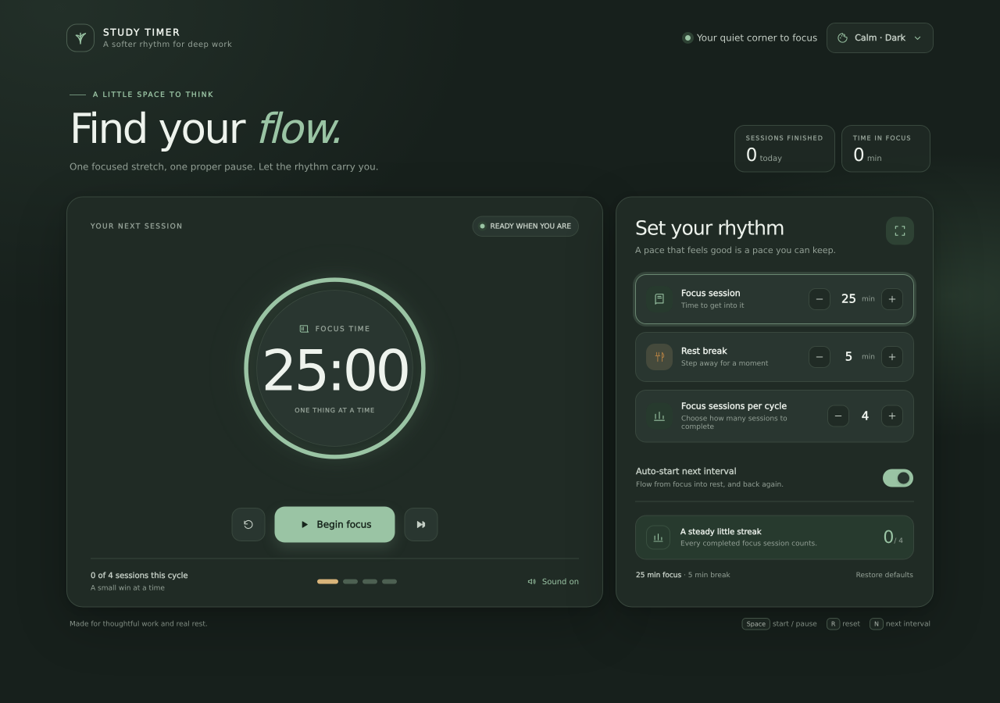
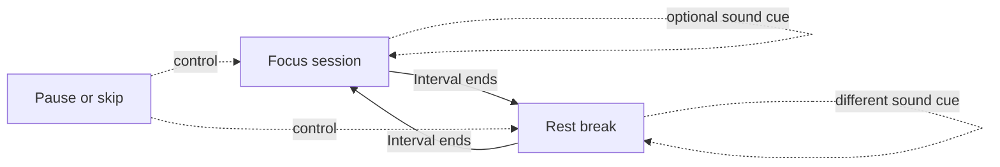
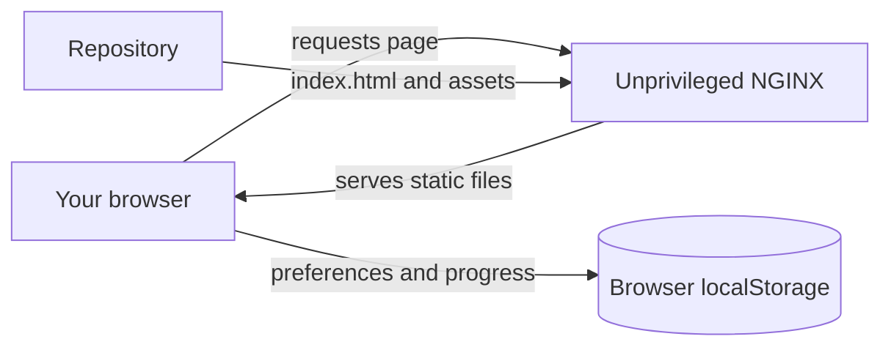
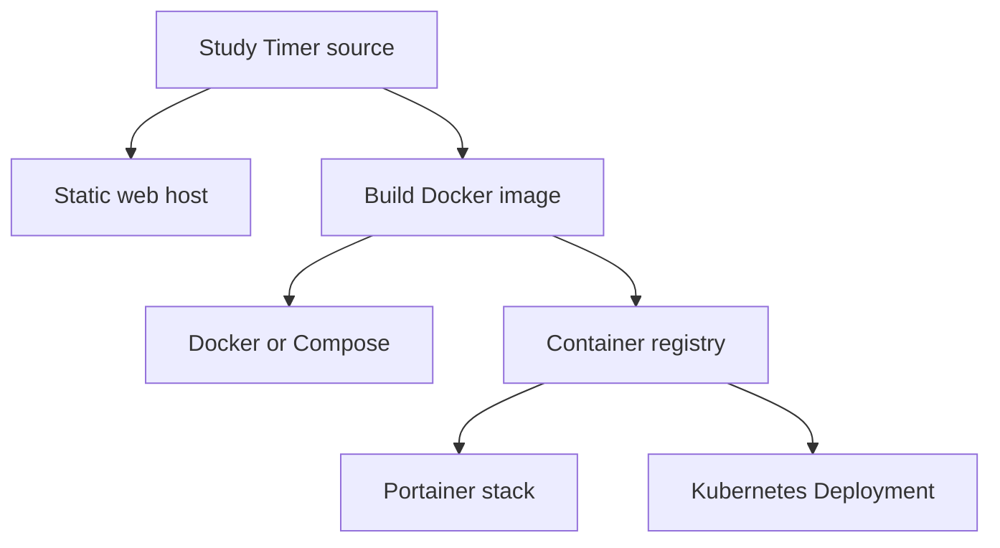

<div align="center">
  
  <h1>Study Timer</h1>
  <p><strong>Make room for focused work and real rest.</strong><br>
  A calm, customizable study timer that moves between focus and break sessions for you.</p>
  <p></p>
  <p><em>Calm · Dark theme</em></p>
  <p><a href="#quick-start">Quick start</a> · <a href="#deploy-with-docker">Docker</a> · <a href="#deploy-with-portainer">Portainer</a> · <a href="#deploy-to-kubernetes">Kubernetes</a></p>
  <p><code>Static app</code> &nbsp; <code>No account</code> &nbsp; <code>Four themes</code> &nbsp; <code>Fullscreen timer</code> &nbsp; <code>Container ready</code></p>
</div>

---

## Find your rhythm

Study Timer keeps the interface quiet while making it easy to shape a work and rest cycle that suits you. Set the intervals, start a session, and let the timer handle the transitions.

| Focus | Break | Make it yours |
| --- | --- | --- |
| Adjustable 1–180 minute focus sessions | Adjustable 1–60 minute breaks | Choose 1–12 focus sessions per cycle |
| Automatic focus-to-break switching | A separate warm break appearance and transition animation | Optional, different audio cues for focus and breaks |
| Daily session and focus-time totals | Optional automatic start for the next interval | Green Calm theme follows your device's light or dark setting by default; restore defaults clears progress |
| Fullscreen timer with an in-view exit control | Animated cycle progress when you change the session count | Focus and break sounds are on by default and can be switched off |

### The session cycle



### How it runs



The app is a static page. It has no server-side database, sign-in, build step, analytics, or third-party runtime dependencies. The timer and preferences run in the browser; the container simply serves the page over HTTP.

## Choose a deployment

| Where you want it | Start here | Image build needed? |
| --- | --- | --- |
| Local Docker | [`compose.yaml`](compose.yaml) | Compose builds it for you |
| Portainer | [`compose.portainer.yaml`](compose.portainer.yaml) | Build and push once, then deploy the image |
| Kubernetes | [`k8s/study-timer.yaml`](k8s/study-timer.yaml) | Build and push once, then update the manifest |
| Static web host | `index.html` and `assets/` | No |



## Quick start

### Run locally

Serve the repository root with a static file server. For example, with Python:

```sh
python3 -m http.server 8000
```

Open <http://localhost:8000>. The page is served directly from `index.html`; there is no install or build command.

### Run with Docker Compose

From the repository root:

```sh
docker compose up --build -d
```

Open <http://localhost:8080>. Stop the app with:

```sh
docker compose down
```

The Compose service builds from the included `Dockerfile`. The container uses the unprivileged NGINX image on port 8080, with a read-only root filesystem, a temporary `/tmp`, and dropped Linux capabilities.

### Run with Docker directly

```sh
docker build -t study-timer:local .
docker run -d --name study-timer \
  --restart unless-stopped \
  -p 8080:8080 \
  --read-only \
  --tmpfs /tmp:rw,noexec,nosuid,size=16m \
  --cap-drop=ALL \
  --security-opt=no-new-privileges:true \
  study-timer:local
```

Open <http://localhost:8080>. To remove the container later, run `docker rm -f study-timer`.

## Deploy with Portainer

Portainer stacks can use the Compose file in [`compose.portainer.yaml`](compose.portainer.yaml). This file expects a prebuilt image. Build steps in Compose stacks are not supported for some remote Portainer environments, so build and push the image before deploying the stack. See [Portainer's stack deployment options](https://docs.portainer.io/user/docker/stacks/add) and [Compose build limitation](https://docs.portainer.io/faqs/known-issues/docker-compose-files-including-build-steps-fail).

### 1. Build and push the image

Replace `OWNER` with the registry owner and choose a version tag. For GitHub Container Registry (GHCR), sign in with an account that can publish packages. Docker prompts for the token:

```sh
docker login ghcr.io --username OWNER
docker build -t ghcr.io/OWNER/study-timer:1.0.0 .
docker push ghcr.io/OWNER/study-timer:1.0.0
```

The registry must allow your Portainer environment to pull the image. For a private image, add registry credentials in Portainer.

### 2. Add the stack

1. In Portainer, open **Stacks** and choose **Add stack**.
2. Choose **Upload** and select `compose.portainer.yaml` from this repository. You can also paste its contents into the Web editor.
3. In the stack environment variables, set `STUDY_TIMER_IMAGE` to the complete image name, for example `ghcr.io/OWNER/study-timer:1.0.0`.
4. Deploy the stack and open `http://<your-docker-host>:8080`.

The stack publishes container port `8080` on host port `8080`. Change the left side of `8080:8080` in the stack file if that host port is already in use. For HTTPS and a domain name, route your reverse proxy to this host port.

## Deploy to Kubernetes

The included manifest creates a namespace, a two-replica Deployment, and a ClusterIP Service. It includes readiness and liveness probes, resource limits, a non-root security context, and a read-only root filesystem.

### 1. Build and push an image

Build an image using a registry your cluster can reach. For GHCR, authenticate Docker first with a token that can publish packages:

```sh
docker login ghcr.io --username OWNER
docker build -t ghcr.io/OWNER/study-timer:1.0.0 .
docker push ghcr.io/OWNER/study-timer:1.0.0
```

Edit the `image` value in [`k8s/study-timer.yaml`](k8s/study-timer.yaml) to match the image you pushed.

### 2. Apply the manifest

```sh
kubectl apply -f k8s/study-timer.yaml
kubectl rollout status deployment/study-timer -n study-timer
kubectl port-forward -n study-timer service/study-timer 8080:80
```

Open <http://localhost:8080>. To expose the app publicly, route your Ingress or Gateway to the `study-timer` Service on port 80 and configure TLS there.

### Private image registry

For a private registry, create an image pull secret in the `study-timer` namespace and reference it from the Deployment. For GHCR, the namespace is created by the manifest; apply it once first, create the secret, then apply it again:

```sh
kubectl apply -f k8s/study-timer.yaml
kubectl create secret docker-registry registry-credentials \
  --namespace study-timer \
  --docker-server=ghcr.io \
  --docker-username="$GITHUB_USER" \
  --docker-password="$GHCR_TOKEN"
```

Add this under `spec.template.spec` in the Deployment in `k8s/study-timer.yaml`:

```yaml
imagePullSecrets:
  - name: registry-credentials
```

Then run `kubectl apply -f k8s/study-timer.yaml` again. Keep registry credentials in a Kubernetes Secret; do not commit them to the repository.

## Deploy as a static site

Upload `index.html` and the `assets/` directory to the document root of your static host. Set the publish directory to the repository root and leave the build command empty. The included `Dockerfile` and Kubernetes files are only needed if you choose a container deployment.

## Controls and privacy

| Key | Action |
| --- | --- |
| <kbd>Space</kbd> | Start or pause |
| <kbd>R</kbd> | Reset the current interval |
| <kbd>N</kbd> | Skip to the next interval |

Timer preferences, theme choice, and daily progress are saved in this browser's `localStorage`. They stay in the current browser profile and do not sync between devices. Sound starts on by default, and you can switch it off in the app. Theme selection follows the device's color scheme until you choose a theme manually.

## Repository layout

```text
.
├── assets/
│   └── icon.svg
├── docs/
│   └── study-timer-screenshot.png
├── k8s/
│   └── study-timer.yaml
├── Dockerfile
├── compose.portainer.yaml
├── compose.yaml
├── index.html
└── nginx.conf
```

<p align="center"><sub>Made for thoughtful work and real rest.</sub></p>
